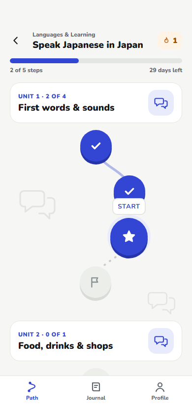
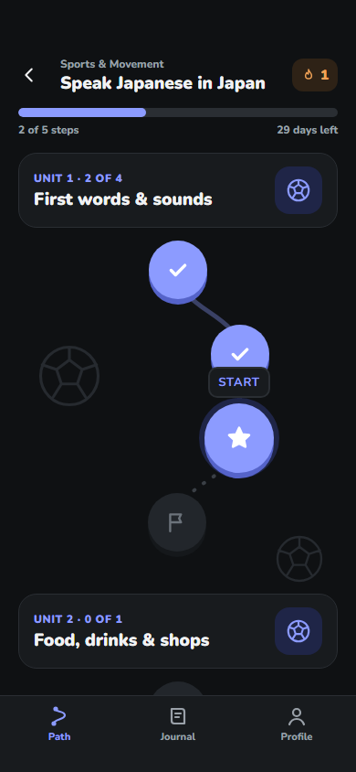

# Verification — 14 October 2026

## Implemented

All 16 mobile screens and the two desktop layouts from the design handoff are implemented. The component comparison route includes the selected A-trail logo and goat, Nunito typography, shared controls and both appearances. Seven categories share one roadmap layout. Screen feature commits follow the handoff order; [DESIGN_CHECKS.md](DESIGN_CHECKS.md) records individual comparisons and deviations.

## Passed

- TypeScript strict checking and Expo ESLint.
- Expo Doctor: 21/21 checks.
- 14 automated domain tests: schema rejection, time budgets, ordered schedules, quiz answers, step locks, streak/calendar boundaries, draft compatibility and patched URL decoding.
- Eight browser regressions against the production web bundle: sign-in entry, failed revision recovery, persisted lesson drafts, direct-link locks, theme persistence, journal, desktop overflow and fetch errors.
- Web production export and iOS Hermes bundle export. This verifies JS/assets, not native signing or device behavior.
- Signed EAS iPhone preview build: Milo 1.0.0 (1), completed 14 October 2026 from commit `8b52d26`. [Build and installation](https://expo.dev/accounts/zhanbo04/projects/milo/builds/25b7fe68-67f1-4352-9c4d-822d5eb4c87a). Native compilation, signing and IPA upload succeeded; the ad hoc provisioning profile includes the registered iPhone. This confirms the native build, not an on-device runtime pass.
- Fourteen rendered category/appearance combinations, plus a 320px long-title / enlarged-web-text check, without horizontal page overflow. This is additional web layout coverage, not a substitute for iOS Dynamic Type testing.
- Server functions pass Deno type checking.
- All eight migration versions and SQL match the connected project's history.
- Exact OpenAI secret value absent from tracked files and both production exports.

The final iOS asset payload is approximately 6.4 MB, reduced from 53.7 MB by importing only the six font weights the app uses. The native JS/Hermes bundle is approximately 5.8 MB.

## Live Supabase and AI checks

A temporary QA account exercised real APIs and AI responses. The full browser flow passed without page errors: enter a goal, clarify, assess feasibility, generate, request an AI revision, save, open a lesson, complete its practice, save a note, upload a private photo, reload the journal, switch to dark and reload.

Additional backend checks passed:

- Out-of-order completion rejected; duplicate completion awards zero additional XP and does not duplicate the note.
- Authenticated users cannot read another account's goal/steps/notes or complete its steps; anonymous requests cannot read goal data.
- AI lesson help and future-plan revision work. Revision preserves completed content, notes and XP, respects already completed minutes today, and rejects stale concurrent edits.
- Missing/empty plan envelopes, null concurrency guards and invalid timezones are rejected without changing stored work.
- Photos are fetched through signed links from the private bucket.
- Account deletion requires confirmation and deletes its private photos before removing the account. The QA account could no longer sign in afterward. Database checks confirmed zero remaining QA users, goals, notes and photos.

No user's existing account or data was used for destructive testing. Local test credentials and logs stay in the ignored `.artifacts/` directory.

## Remaining setup and unverified behavior

- Apple and Google providers are still disabled. Their developer-account credentials and allowed redirect configuration must be supplied as described in [SETUP.md](SETUP.md). Email is enabled, but an actual magic-link email delivery/return was not tested.
- The signed iPhone preview is ready to install. No signed Android build, TestFlight upload or App Store submission was performed. Native Apple sign-in, keyboard/safe-area behavior, VoiceOver/Dynamic Type, speech, haptics, photo permissions and scheduled reminders still require a real-device pass.
- Published privacy and terms URLs are still missing. Storia and Plus intentionally remain Soon.
- Web hosting is not provisioned; add its origin to the server CORS allowlist when deploying.

## Dependency and database audit

The vulnerable URI decoder was upgraded to 0.5.0 with a tested CommonJS/ESM adapter for the Expo Router dependency chain. Xcode's UUID dependency was upgraded to 11.1.1; generation was checked. A clean install applies the adapter through `postinstall`.

`npm audit` still reports 18 high-severity entries propagated through Expo build tooling from **braces 3.0.3** and **node-forge 1.4.0**, for which no patched release was available at verification time. These are not claimed fixed; do not use `npm audit fix --force`, which proposed incompatible Expo versions. Track the [braces advisory](https://github.com/advisories/GHSA-vfj7-8cjw-p6xm) and [node-forge advisory](https://github.com/advisories/GHSA-86w9-cpqp-85rv) and update through Expo-compatible releases.

Supabase's advisor flags authenticated access to SECURITY DEFINER RPCs; this is intentional for atomic, ownership-checked save/complete/revise/quota operations. Usage tables intentionally have no client-readable RLS policy. Equivalent legacy policies were consolidated and the missing notes foreign-key index was added. The project also reports leaked-password protection disabled; the app exposes OAuth and magic links, not password sign-up. That project-level option was not changed through the available MCP tools.

## Visual samples

The samples below use test data; category motifs and palettes change while geometry stays shared.

